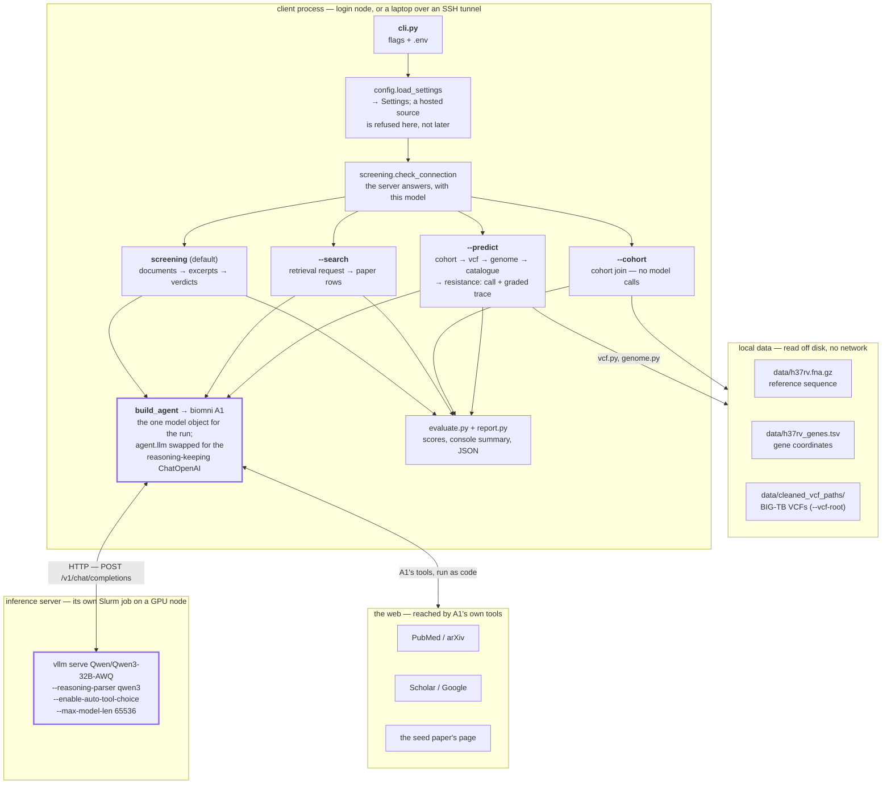

# tb-knowledge-discovery

The pipeline uses Biomni A1 to retrieve papers, screen documents for TB
relevance, and evaluate drug resistance predictions on BIG-TB VCFs against
phenotypic drug susceptibility labels. It runs against a self-hosted model
served by vLLM or Ollama. [Biomni](https://github.com/snap-stanford/Biomni)

## Setup

Run these commands from the repository root. On Unity, load `uv` first.

```bash
module load uv  # Unity only
uv sync
```

For direct `cli.py` commands, copy `.env.example` to `.env` if you want to
save model settings. The experiment runner uses its profile defaults and
command-line flags.

## Run an experiment

`run.sh` runs the cohort join, predicts resistance for each requested drug, and
screens the papers against the labels in `eval/screening_gold.json`. It submits
and follows a Slurm job if `sbatch` is available. Use `--slurm` or `--local`
to select the execution mode explicitly.

```bash
./run.sh --profile demo
./run.sh --profile quick          # default profile
./run.sh --profile full
./run.sh --help
```

| Profile | Unity allocation | Model and context | Sample | Prediction effort |
| --- | --- | --- | --- | --- |
| `demo` | 16+ GB GPU, 1 h | Qwen3-8B-AWQ, 32,768 tokens | 4 rifampicin isolates | low |
| `quick` | 23+ GB GPU, 2 h | Qwen3-14B-AWQ, 40,960 tokens | 8 rifampicin isolates | medium |
| `full` | A100, 8 h | Qwen3-32B-AWQ, 65,536 tokens | 20 isolates per drug for rifampicin, isoniazid, ethambutol, and pyrazinamide | high |

All profiles sample equal resistant and susceptible counts by default. A drug
with few labelled isolates in either class can yield fewer than `--limit`.
The demo uses agent tool selection and one document per screening batch. Use
`--tools` and `--batch-size` to adjust these settings in any profile.

On Unity, the first job creates `~/vllm-venv` and downloads the model weights.
Use project or work storage for the model cache and allow time for first-run
setup. The VCFs must also be readable from the compute node. If they have
moved, pass the directory containing the VCF files with `--vcf-root`.

```bash
export HF_HOME=/work/pi_annagreen_umass_edu/$USER/hf

./run.sh --slurm --profile full \
    --drugs "rifampicin isoniazid" --limit 40 --seed 7 \
    --vcf-root /path/to/vcfs --run-id two-drug-seed7 \
    --sbatch-arg --time=12:00:00
```

Pass `--submit-only` to return after submission. Ctrl-C detaches from a job you
are following. Use `--attach` to reconnect, or `scancel JOB_ID` to cancel it.

```bash
./run.sh --attach 1234567
tail -f logs/tb-1234567.out
./run.sh --status results/two-drug-seed7
```

### Use an existing model server

```bash
./run.sh --local --profile full --base-url http://localhost:8000/v1 \
    --model Qwen/Qwen3-32B-AWQ --vcf-root ./vcfs
```

For Ollama, start the server with `OLLAMA_CONTEXT_LENGTH=32768 ollama serve`
and run `ollama pull qwen3:8b`. Then run the demo against it.

```bash
./run.sh --local --profile demo --source Ollama --model qwen3:8b --vcf-root ./vcfs
```

For local resistance prediction, select the files with the same drug, limit,
balance and seed as the experiment. `--vcf-root` expects a flat directory of VCF
files.

```bash
uv run cli.py --vcf-paths rifampicin --limit 4 --balance --seed 0 > vcfs.txt
rsync -av --no-relative --files-from=vcfs.txt unity.rc.umass.edu:/ ./vcfs/
```

### Run a single stage or serve a model

Use `--cli` to pass arguments straight to `cli.py` after the runner's server
settings. For model-free commands such as `--cohort` and `--vcf-paths`, you can
also call `cli.py` directly.

```bash
./run.sh --local --cli --cohort -o /tmp/cohort.json
./run.sh --slurm --profile demo --cli --search "TB literature related to <paper URL>"
./run.sh --slurm --profile full --cli --predict rifampicin --limit 40 --balance
./run.sh --slurm --profile full --submit-only --serve-only
```

A server-only job prints its URL in the Slurm log and serves until the job
ends. For a client off-cluster, forward the job's port over SSH and use the
forwarded address as `--base-url`.

### Find and package results

An experiment writes to `results/<run-id>/`. The directory holds the stage
JSON, stage logs, timing and exit records, run metadata, a `SUMMARY.md`, and
`metrics.csv` when predictions are available. GPU and vLLM timelines are
recorded when those services are available. The runner also creates
`results/<run-id>.tar.gz` and updates the run's row in `results/runs.csv`.

A failed stage is recorded and the remaining stages still run. The runner
packages the available results before returning a nonzero exit status.
To rebuild a report after a run has finished or been interrupted, use
`--collect`. With no directory, it selects the most recently modified run
directory under `results/`.

```bash
./run.sh --collect results/two-drug-seed7
```

## Resistance prediction from VCFs

The dataset comes from two files in `data/cleaned_vcf_paths/`:
`master_resistance_table.csv` (phenotypic DST, R/S per isolate per drug) and
`big_tb_file_paths.txt` (the BIG-TB VCF paths on the cluster). They join on the
table's `New_ID` column, which matches the VCF filename stem for all 17,942
BIG-TB isolates, giving a labelled dataset per drug — 17.6k isolates for
rifampicin, 17.4k for isoniazid, down to a few dozen for the rarely tested
drugs.

Variants are named without needing an annotated VCF. Each position is looked up
in `data/h37rv_genes.tsv` (NCBI's feature table for H37Rv, NC_000962.3) to get
the gene, the codon number, or a promoter offset, and the codon is then
translated against the reference in `data/h37rv.fna.gz` to get the actual
protein consequence. So `761155 C>T` is presented as `rpoB S450L`, `761156 G>A`
as `rpoB S450S synonymous`, `1673425 C>T` as `fabG1 -15 (promoter)` and a 1 bp
deletion in pncA as a frameshift. When the VCF carries its own `ANN`/`CSQ`
field, that annotation is used instead.

Naming the protein change matters more than it looks: shown only "rpoB codon
453", the model calls any hotspot codon resistant, because it cannot tell a
silent change from a missense one. Shown "rpoB S450S synonymous", it correctly
rules the variant out.

Because the reference is loaded anyway, every record's `REF` is checked against
H37Rv. A run that reports mismatches was called against a different reference or
has shifted coordinates, and its gene and codon assignments cannot be trusted.

Variants are then filtered to the genes the WHO catalogue grades for that drug,
split into tier 1 (established mechanism) and tier 2 (secondary).

**Each trace is checked, not just read.** Every prediction is stored next to the
variants it was shown, so three things are verified mechanically:

| check | what it catches |
| --- | --- |
| `variants_resolve` | the model cited a variant that was never in the VCF |
| `genes_on_panel` | the model reasoned from a gene not graded for that drug |
| `call_grounded` | a `resistant` call that rests on no variant at all |

`tier1_support` additionally records whether the call rests on a tier 1 gene
rather than only a secondary one. A trace is `valid` when nothing in it was
invented or self-contradictory — accuracy and trace validity are reported
separately, because a run can be accurate and still be reasoning from variants
that were not there.

```bash
# the labelled dataset size per drug; no LLM calls
uv run cli.py --cohort

# predict, on a balanced sample, with the VCFs mounted locally
uv run cli.py --predict isoniazid --limit 40 --balance --vcf-root /path/to/vcfs
uv run cli.py --predict rifampicin --limit 100 --balance --seed 1
```

The BIG-TB VCFs live on the cluster, so `--vcf-root` points at wherever they
actually are; without it the recorded cluster path is used as-is. A run prints
one line per isolate (the call, whether it matched the DST, and any trace
problem) and ends with accuracy, sensitivity, specificity, PPV/NPV, the
confusion matrix and the trace rates. `tb_resistance_<drug>.json` holds every
prediction with its variant list, reasoning and trace grade.

## Model serving

The experiment runner starts vLLM with the Qwen3 reasoning parser and Hermes
tool parser. The reasoning parser supplies the per-request trace as its own
response field. The context window must fit A1's tool catalogue and the agent's
history. With `--tools`, A1 selects a smaller set of tools for each task.

| Backend | Setup | Trace format |
| --- | --- | --- |
| `Custom` | OpenAI-compatible endpoint, such as vLLM | Separate reasoning field when the server supplies one |
| `Ollama` | Local Ollama server with the model pulled | Inline `<think>` tags when the model returns them |

For a manually started vLLM server, use the same settings as the full profile.

```bash
vllm serve Qwen/Qwen3-32B-AWQ --port 8000 \
    --gpu-memory-utilization 0.90 --max-model-len 65536 \
    --reasoning-parser qwen3 --enable-auto-tool-choice --tool-call-parser hermes
```

Use `--max-model-len` and `--port` on `run.sh` to override the vLLM settings
for a Slurm job. For scheduler overrides, repeat `--sbatch-arg` with one option
per occurrence, such as `--sbatch-arg --partition=gpu-preempt-highvram`.

## Direct CLI usage

**Screening local documents**

```bash
uv run cli.py                        # screens ./papers, or ../papers when ./papers is absent
uv run cli.py ../papers               # any directory or single PDF/text file
uv run cli.py -o out.json             # default output: tb_verdicts.json
uv run cli.py --batch-size 1          # one document per agent run, for a tight context window
uv run cli.py --gold eval/screening_gold.json   # plus accuracy against hand labels
```

Documents go to the agent `--batch-size` at a time, as section-aware excerpts
(the opening, plus the starts of the methods and closing sections — the opening
alone cannot tell a TB methods paper from one that names TB in passing). A batch
whose reply will not parse is retried once with a stricter reminder, then left
as `unknown`, so one bad agent run cannot end a pass over a whole directory.

**Retrieval**

```bash
uv run cli.py --search "find me relevant papers like this paper https://www.biorxiv.org/content/..."
uv run cli.py --search "..." -n 20 -o found.json   # at most 20 papers
uv run cli.py --search "..." --verbose             # biomni's full step-by-step agent output
```

A retrieval run echoes the agent's searches as it makes them (the step number in
brackets), then the papers it settled on:

```
Searching for up to 10 paper(s) [A1 agent, Custom Qwen/Qwen3-32B-AWQ @ http://gpu042:8000/v1]
  query: find me relevant papers like this paper https://...

  [2] extract_url_content(https://www.biorxiv.org/content/...)
  [4] query_pubmed(rifampicin resistance prediction whole genome sequencing)
  [6] query_scholar(tuberculosis drug resistance benchmark)
  [8] agent wrote up its answer

Papers related to the query (8):
   1. TB-Bench: A Systematic Benchmark of ... (2026) [pubmed]
      https://doi.org/10.64898/2026.04.08.717138
      Provides a TB drug resistance benchmark similar to BIG-TB.
```

Every row has to carry a title the agent actually returned, and the agent is
told never to invent one — but unlike a search against a source API directly,
nothing here can *prove* a row came from a real record. Spot-check the links.

## Architecture

Two processes and an HTTP boundary. The pipeline runs wherever you launched it
— a login node, or a laptop through an SSH tunnel — and knows the model only as
a URL; the model runs in its own Slurm job on a GPU node. Nothing in the
pipeline holds weights, and nothing in the server holds pipeline state, so the
server can be restarted, resized or swapped for a different model id without
touching the code.



The layering is deliberate in three places:

- **Biomni supplies the agent; the pipeline around it is this repo's.** A1
  brings the tool loop, the tool catalogue and its own ~35k-token system
  prompt. Every task prompt, the VCF reader and all the grading are this
  repo's (see [How it uses Biomni](#how-it-uses-biomni)).
- **The genomic layer is pure and offline.** `vcf.py`, `genome.py` and
  `catalogue.py` turn a VCF into named, panel-filtered variants with no model
  in the loop, which is why `tests/` can cover them without a server.
- **Grading is separate from predicting.** `resistance.check_trace` and
  `evaluate.py` only read rows, so a finished run can be re-scored from its JSON.

## How a run flows

Every mode enters through `cli.py`, which parses flags, loads `Settings` from
`.env` and picks a path. Everything below the CLI is plain Python, and every
model call is `run_agent` — one `agent.go()` over one task prompt.

**Screening (the default mode)**

```
cli.py run_screening
  load_settings            config.py      .env -> Settings
  resolve_input            documents.py   the directory or single file to read
  collect_docs             documents.py   every PDF/text under it
  check_connection         screening.py   the server's model list + a 1-token call, so a server that is down fails here
  build_agent              screening.py   biomni.agent.A1, wired to our server
  classify_documents_agent screening.py   one agent run per --batch-size documents
    section_excerpt        documents.py   opening + methods + conclusion
    BATCH_SCREEN_PROMPT    prompts.py     the listing -> one JSON list
    run_agent              screening.py   agent.go, plus the run's thinking
    parse_verdict_list     verdicts.py    salvage that JSON from prose or code fences
    quote_in_text          verdicts.py    the evidence quote checked against the excerpt
  write_results            report.py      console lines + tb_verdicts.json
```

**Retrieval (`--search`)**

```
cli.py run_search
  build_agent            screening.py   as above
  retrieve_papers        retrieval.py   one agent run on the request
    RETRIEVAL_PROMPT     prompts.py     fetch the seed, then search; reply as a JSON list
    go_stream            biomni         step by step, so the searches can be echoed
    _searches            retrieval.py   the tool calls, read back out of the code A1 wrote
    parse_paper_list     verdicts.py    salvage the rows from the final reply
  write_papers           report.py      rows -> tb_papers.json
```

`--predict` is the same shape per isolate: the VCF is read and named offline,
`RESISTANCE_PROMPT` hands the agent the numbered variant list, and the reply is
parsed, normalized and then checked against what was in that list.

## The lifecycle of one request

Setup happens once per run; the rest repeats per document, per candidate paper
or per isolate. The model is never trusted to have answered well — every reply
is salvaged, normalized and checked before it becomes a row.

```mermaid
flowchart TB
    subgraph setup["once, before the first call"]
        L1["config.load_settings<br/>.env + flags → Settings"]
        L2["screening.check_connection<br/>the model list, then a 1-token call:<br/>a server that is down, or serving a<br/>different id, fails here"]
        L3["screening._prime_environment<br/>BIOMNI_CUSTOM_BASE_URL / _API_KEY,<br/>where biomni's own code looks"]
        L4["build_agent<br/>one A1 agent for the whole run;<br/>agent.reasoning_traces attached"]
        L1 --> L2 --> L3 --> L4
    end

    subgraph percall["per document, per candidate paper, per isolate"]
        P1["task prompt built — prompts.py<br/>a batch of section excerpts, a numbered<br/>variant listing, or the retrieval request"]
        P2["screening.run_agent<br/>agent.go — A1's tool loop, its ~35k-token<br/>system prompt on every step"]
        P3["screening.retry_transient<br/>POST /v1/chat/completions, per step"]
        P4["vLLM<br/>prefill → decode; the reasoning parser<br/>splits the thinking out of the answer"]
        P5["(answer, trace) — langchain drops that<br/>field as non-standard and A1 rebuilds the<br/>message, so the ChatOpenAI subclass files<br/>each trace in agent.reasoning_traces;<br/>on Ollama it comes out of the think tags"]
        P6["verdicts.parse_verdict_list<br/>or resistance.parse_prediction<br/>the JSON, out of prose, fences or solution tags"]
        P7["verdicts.quote_in_text — screening<br/>the evidence quote checked against the excerpt<br/><br/>normalize_prediction — resistance.py<br/>the call folded to one of three"]
        P8["resistance.check_trace<br/>variants_resolve, genes_on_panel,<br/>call_grounded, tier1_support"]
        P9["one row, always"]
        P1 --> P2 --> P3 --> P4 --> P5 --> P6 --> P7 --> P8 --> P9
        RETRY["a busy or restarting server:<br/>retried twice. a context-length<br/>failure: not retried, it would repeat —<br/>cut --batch-size or raise --max-model-len"]
        P3 -.-> RETRY -.-> P3
        P6 -.->|"unreadable VCF, failed call,<br/>unparseable reply → a row<br/>carrying an error, so one bad<br/>input cannot end a sweep"| P9
    end

    subgraph finish["once, at the end"]
        F1["evaluate.py<br/>accuracy and trace validity scored apart:<br/>a run can be accurate and still reason<br/>from variants that were not there"]
        F2["report.py<br/>console summary + JSON, with the model id<br/>and reasoning effort recorded — traces<br/>only compare across runs at equal effort"]
        F1 --> F2
    end

    L4 --> P1
    P9 -->|"next item"| P1
    P9 --> F1

    classDef remote stroke-width:3px
    class P4 remote
```



One `agent.go()` is however many requests A1's tool loop needs, each carrying
that system prompt, so the per-item cost is set by how many steps the agent
takes rather than by the task prompt's length. `--tools` lets A1 retrieve a
relevant tool subset instead of carrying the whole catalogue, which is the one
lever on that cost short of a smaller prompt.

## How it uses Biomni

Biomni supplies the agent; the pipeline around it is this repo's, including
every task prompt (`prompts.py`). A1 brings its own system prompt — who it is,
the tool catalogue, the `<execute>`/`<solution>` protocol — but no task prompts,
because its design is that the caller supplies the task in `agent.go(...)`.
The touchpoints are few:

| Biomni piece | Where | Used for |
| --- | --- | --- |
| `biomni.agent.A1` | `screening.build_agent` | the one model object: tool loop, tool retriever, data-lake switch |
| `biomni.config.default_config` | `screening.build_agent` | temperature, model and provider; A1 forwards `llm`/`source` but not `temperature` |
| `agent.go(prompt)` | `screening.run_agent` | every task: screening batches, and one resistance prediction per isolate |
| `agent.go_stream(prompt)` | `retrieval._run_streamed` | search step by step, so its tool calls can be echoed |
| A1's retrieval tools | the `--search` run | `query_pubmed`, `query_arxiv`, `query_scholar`, `search_google`, `extract_url_content`, called as code inside `<execute>` |

Six details are easy to get wrong, which is why the code spells them out:

- The source is always passed explicitly. Biomni's auto-detection sees the
  slash in a HuggingFace id like `Qwen/Qwen3-32B-AWQ` and would route it to Ollama
  on its own. `Custom` is the branch that points langchain at our server; A1
  takes `base_url` too, so the agent's tool calling runs against it.
- The endpoint is copied into the environment (`BIOMNI_CUSTOM_BASE_URL`,
  `BIOMNI_CUSTOM_API_KEY`) before `A1` is built, because Biomni reads it from
  there, not from our `Settings`.
- A1 builds its own chat model, so `build_agent` replaces `agent.llm` with the
  reasoning-keeping one afterwards; it stays a `ChatOpenAI` subclass because A1
  calls `with_structured_output` on it.
- `expected_data_lake_files=[]` (not `None`) is what tells A1 to skip its
  tens-of-GB data-lake download; `--data-lake` turns it back on.
- `timeout_seconds` comes from `BIOMNI_TIMEOUT_SECONDS` (default 600) and is
  passed only to A1.
- A1's `generate` step appends a **new** `AIMessage` built from the reply's text,
  so `additional_kwargs` never reaches the graph state and `go()` hands back a
  bare string. The reasoning is therefore collected at the chat model, in
  `agent.reasoning_traces`, and `run_agent` clears that list per run so one
  isolate's thinking is not filed under the next.

That system prompt rides on every step of every run, so the per-item cost is
real: a sweep over thousands of isolates pays it thousands of times, and
`--tools` (a retrieved tool subset) is the lever on it. Where a run can still
fail, `retry_transient` retries a busy or restarting server twice, and a failure
is reported per batch or per isolate instead of ending the run.

## Direct CLI flags

| flag | meaning |
| --- | --- |
| `input` (optional) | Directory or file to screen; defaults to `./papers`, else `../papers` |
| `--search QUERY` | Retrieval request; typically names a seed paper by URL/DOI. Output: `tb_papers.json` |
| `-n`, `--top` | `[--search]` Upper bound on papers returned, most relevant first (default 10) |
| `--gold JSON` | `[screening]` Hand labels `{filename: true/false}`; prints accuracy |
| `--cohort` | Join the resistance table to the listed VCFs; per-drug dataset sizes. Output: `tb_cohort.json` |
| `--predict DRUG` | Predict resistance to DRUG from each isolate's VCF, with a checked trace. Output: `tb_resistance_<drug>.json` |
| `--vcf-paths DRUG` | Print the selected sample's VCF paths without model calls |
| `--relative-to DIR` | [`--vcf-paths`] Print paths relative to this directory |
| `--vcf-root DIR` | `[--predict]` Where the VCFs actually live, replacing the recorded cluster path |
| `--data-dir DIR` | `[--cohort]`, `[--predict]` Where the cohort files live (default `data/cleaned_vcf_paths`) |
| `--limit N` | `[--predict]` Isolates to predict over (default 20) |
| `--balance` | `[--predict]` Equal numbers of resistant and susceptible isolates |
| `--seed N` | `[--predict]` Sampling seed, so a run repeats (default 0) |
| `--min-af` | `[--predict]` Drop variants below this alternate-allele frequency (default 0, keep all) |
| `--keep-filtered` | `[--predict]` Also use variants the caller did not mark PASS |
| `-o, --output` | JSON results path (default `tb_verdicts.json`, or `tb_papers.json` with `--search`) |
| `--model` | Model id to request: on vLLM the id the server was started with, on Ollama the pulled tag (default: `$VLLM_MODEL` or `Qwen/Qwen3-32B-AWQ`) |
| `--base-url URL` | Where the model is served, e.g. `http://gpu042:8000/v1` (default: `$VLLM_BASE_URL` or `http://localhost:8000/v1`). A1 does its tool calling against it too |
| `--reasoning-effort LEVEL` | Reasoning effort sent with every request: `none`, `minimal`, `low`, `medium`, `high`, `xhigh`, `max` (default: `$LLM_REASONING_EFFORT`, else the server's own default) |
| `--source` | Which biomni backend serves the model: `Custom` (any OpenAI-compatible server, i.e. vLLM) or `Ollama` (default: `$LLM_SOURCE` or `Custom`). Both drive A1; only `Custom` hands back separated traces |
| `--batch-size` | `[screening]` Documents per agent run (default 2) |
| `--max-chars` | Excerpt length per document (default 3000) |
| `--tools`, `--no-tools` | Enable or disable selection of relevant agent tools |
| `--data-lake` | Let biomni pull its full data lake (tens of GB) |
| `--temperature` | Sampling temperature (default 0.2) |
| `--verbose` | `[--search]` Also print biomni's full step-by-step agent output |

## Layout

```
run.sh             experiment runner for local servers and Slurm
cli.py             individual pipeline commands
tb_search/
  config.py        Settings loaded from .env / environment: which local backend, which model
  reasoning.py     reasoning effort, and pulling a reply's thinking out of it
  documents.py     collect files, extract text and section-aware excerpts
  prompts.py       the task prompts handed to A1: screening, retrieval, resistance
  verdicts.py      salvage JSON out of whatever the model returned; check a quote against its text
  evaluate.py      screening accuracy, resistance scoring, trace grading
  screening.py     A1 construction, one-run-per-prompt, and agent screening
  retrieval.py     one A1 agent run: query (+ seed paper URL) -> paper rows
  report.py        summary line + JSON output (verdicts, searches, predictions)
  experiment_report.py  experiment summary, run ledger, and archive
  genome.py        H37Rv position -> gene, codon, promoter offset, protein change
  catalogue.py     WHO drug -> resistance gene panels, tier 1 and tier 2
  vcf.py           read a VCF into named, panel-filtered variants
  cohort.py        join the resistance table to the VCF paths; per-drug datasets
  resistance.py    predict resistance for one isolate/drug, and grade the trace
data/
  h37rv_genes.tsv        H37Rv gene coordinates (from NCBI NC_000962.3)
  h37rv.fna.gz           the H37Rv reference sequence, for protein consequences
  cleaned_vcf_paths/     the resistance table and the BIG-TB VCF path list
eval/              hand labels for screening
tests/             offline tests for the VCF pipeline and the model layer
```
